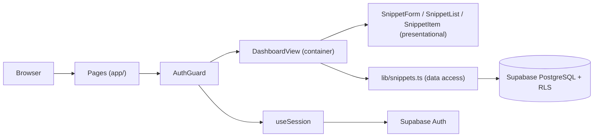

# Snippet Manager

A minimal, private code-snippet manager. Sign up, save snippets with a title, category and code, then edit or delete them. Every snippet is visible only to its owner, enforced by the database itself.

Built as a focused MVP: small surface, no unnecessary dependencies, clear boundaries between UI, state and data access.

## Features

- One-click demo account, so visitors can try the app without registering.
- Email and password authentication (sign up, sign in, sign out).
- Create, list, edit and delete your own snippets.
- Fixed categories (`javascript`, `typescript`, `python`, `sql`, `bash`, `css`, `html`, `note`, `other`).
- Owner-only data access through PostgreSQL Row Level Security.

## Tech stack

| Layer | Technology |
|-------|------------|
| Framework | [Next.js 16](https://nextjs.org) (App Router, Turbopack) |
| Language | TypeScript |
| Styling | Tailwind CSS 4 |
| Auth and database | [Supabase](https://supabase.com) (Auth + PostgreSQL) via `@supabase/supabase-js` |
| Tooling | ESLint |

## Architecture



```text
app/
  dashboard/page.tsx      Private page: AuthGuard + DashboardView
  login/page.tsx          Guest page: AuthGuard + AuthForm
  register/page.tsx       Guest page: AuthGuard + AuthForm
components/
  auth/AuthForm.tsx       Sign-in / sign-up form (single component, two modes)
  auth/AuthGuard.tsx      Client-side route guard (private | guest)
  dashboard/              Container: owns snippet state and Supabase calls
  snippets/               Presentational: form, list, item (render + emit events)
hooks/useSession.ts       Current session, synced with onAuthStateChange
components/layout/Navbar.tsx  Global navigation, adapts to the auth state
lib/config.ts             App name and optional demo account (env-driven)
lib/supabase.ts           Single Supabase client, fails fast on missing env vars
lib/snippets.ts           Data access: list, create, update, delete
supabase/migrations/      SQL schema, RLS policies and grants
```

Key decisions:

| Decision | Why |
|----------|-----|
| Container / presentational split | `DashboardView` is the only component that talks to Supabase; UI components stay dumb and reusable (`SnippetForm` serves both create and edit). |
| Data access module | Components never build queries; `lib/snippets.ts` is the single place to change if the schema evolves. |
| Client-side session (`supabase-js`) | Simplest setup for an MVP. The session lives in the browser, so route protection runs on the client (see [Security](#security)). |
| `/` redirect in `next.config.ts` | A config-level redirect avoids rendering a page just to redirect. |

## Getting started

### Prerequisites

- Node.js 20.9+ and npm
- A free [Supabase](https://supabase.com/dashboard) project

### 1. Install

```bash
git clone https://github.com/ABJR2000/website-ia.git
cd website-ia
npm install
```

### 2. Configure environment variables

Create a `.env.local` file in the project root:

```bash
NEXT_PUBLIC_SUPABASE_URL=https://your-project-ref.supabase.co
NEXT_PUBLIC_SUPABASE_ANON_KEY=your-publishable-or-anon-key

# Optional: shows a "Try the demo account" button on /login
NEXT_PUBLIC_DEMO_EMAIL=demo@example.com
NEXT_PUBLIC_DEMO_PASSWORD=choose-a-demo-password
```

Find both values in the Supabase dashboard:

| Variable | Where |
|----------|-------|
| `NEXT_PUBLIC_SUPABASE_URL` | Project Settings → Data API → Project URL |
| `NEXT_PUBLIC_SUPABASE_ANON_KEY` | Project Settings → API Keys → Publishable key (or the legacy `anon` key) |
| `NEXT_PUBLIC_DEMO_EMAIL` / `NEXT_PUBLIC_DEMO_PASSWORD` | Credentials of the demo user you create in step 4 (optional) |

> The variable name must be `NEXT_PUBLIC_SUPABASE_ANON_KEY`, even if you copy the newer *publishable* key. Restart the dev server after editing `.env.local`.

### 3. Create the database schema

In the Supabase dashboard, open **SQL Editor** and run the migrations in order:

1. `supabase/migrations/20261103000000_create_snippets.sql`
2. `supabase/migrations/20261103000100_allow_snippet_updates.sql`

Optional, for faster local testing: disable **Authentication → Providers → Email → Confirm email** so sign-up logs you in immediately.

### 4. Create the demo account (optional)

In **Authentication → Users → Add user → Create new user**, enter the email and password from `NEXT_PUBLIC_DEMO_EMAIL` / `NEXT_PUBLIC_DEMO_PASSWORD` and check **Auto Confirm User**. Then sign in once and add a few sample snippets so visitors land on a populated dashboard.

> The demo credentials are public on purpose (they are shown on the login page). Use a throwaway account with no real data. All visitors share it, so they can see and edit each other's demo snippets.

### 5. Run

```bash
npm run dev
```

Open [http://localhost:3000](http://localhost:3000). You will be redirected to `/login`.

## Scripts

| Command | Description |
|---------|-------------|
| `npm run dev` | Start the development server |
| `npm run build` | Production build (requires the env vars) |
| `npm run start` | Serve the production build |
| `npm run lint` | Run ESLint |

## Security

Security is enforced in the database, not in the UI.

| Practice | How |
|----------|-----|
| Row Level Security | RLS is enabled on `snippets`. Policies allow `select`, `insert`, `update` and `delete` only when `auth.uid() = user_id`, and only for the `authenticated` role. |
| Server-assigned ownership | `user_id` defaults to `auth.uid()`; the client never sends it, so it cannot be spoofed. |
| Immutable columns | A column-level `GRANT UPDATE (title, content, category)` prevents changing `user_id` or `created_at`, even with a hand-crafted request. |
| Public key only | The browser uses the publishable (anon) key, which grants nothing on its own; access depends on the user's session plus RLS. The `service_role` key is never used in the app. |
| Input constraints | Title length is checked in the database (`1–200` chars) and in the form. |
| Fail-fast config | `lib/supabase.ts` throws at startup if the Supabase env vars are missing. |
| Route protection | `AuthGuard` redirects signed-out users from private pages to `/login` and signed-in users away from guest pages. |

**Why no server middleware (proxy)?** The session is stored in the browser (`localStorage`) by `supabase-js`, which a Next.js proxy running on the server cannot read. Client-side guarding is therefore a UX layer; the real protection is RLS, so even a direct API call with the public key cannot read or modify another user's data. Moving the session to cookies with `@supabase/ssr` would enable server-side route protection (see roadmap).

## Roadmap

- Server-side auth with `@supabase/ssr` and a Next.js `proxy` for route protection.
- Search and filter by category.
- Syntax highlighting.
- Automated tests (unit for the data layer, end-to-end for the auth and CRUD flows).
